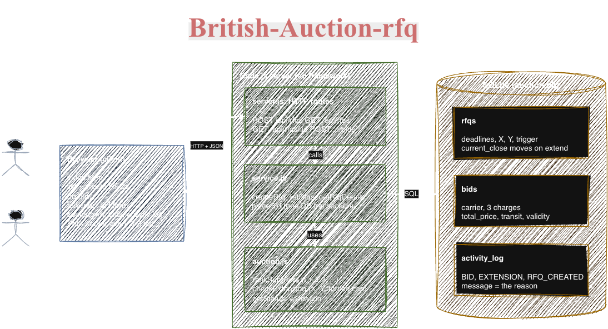

# High-Level Design

## What the system does

This application lets a buyer create an RFQ and lets carriers submit bids.
The lowest bid gets the best rank. If a bid arrives close to the closing time,
the auction can be extended.

## Simple architecture




- **Browser**: Shows RFQs, rankings, bids, and the activity log.
- **server.js**: Receives API requests and sends responses.
- **service.js**: Creates RFQs, saves bids, and manages database transactions.
- **auction.js**: Contains ranking, validation, status, and extension rules.
- **SQLite**: Stores RFQs, bids, and activity history.

## Main files

| File | Purpose |
|---|---|
| `public/index.html` | Lists RFQs and creates a new RFQ |
| `public/rfq.html` | Shows one RFQ and accepts bids |
| `src/server.js` | HTTP server and API routes |
| `src/service.js` | Application and database logic |
| `src/auction.js` | Auction rules |
| `src/schema.sql` | Database tables |
| `public/scripts/` | Browser scripts |
| `scripts/seed.js` | Demo data script |

## Database

The database has three tables:

- **rfqs**: RFQ details, start time, closing times, and extension settings.
- **bids**: Carrier bids and their total prices.
- **activity_log**: RFQ creation, bid, and extension events.

One RFQ can have many bids and many activity log entries.

## How a bid works

1. Validate the carrier name, charges, transit time, and quote validity.
2. Start a database transaction.
3. Check that the RFQ exists, has started, and is still open.
4. Check that the carrier's new bid is lower than its previous best bid.
5. Save the bid and add it to the activity log.
6. Recalculate the supplier rankings.
7. If the bid meets the extension rule, move the closing time forward.
8. Never move the closing time past the forced-close time.
9. Commit the transaction. If an error occurs, roll it back.

## Extension rules

An extension is considered only when a bid is placed inside the configured
trigger window:

- **ANY_BID**: Any bid extends the auction.
- **ANY_RANK_CHANGE**: An existing supplier must change position.
- **L1_CHANGE**: The supplier in first place must change.

The new closing time is:

```text
current close + extension time
```
